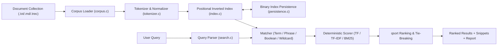

# CSIR System Architecture & Algorithmic Analysis

## 1. End-to-End Pipeline

## 2. Core Data Structures

### 2.1 Primary Hash-Table Inverted Index
- **Hash Function**: 64-bit FNV-1a (`offset = 14695981039346656037`, `prime = 1099511628211`).
- **Collision Resolution**: Separate chaining via `TermEntry *next`.
- **Dynamic Rehashing**: Power-of-two bucket table doubles whenever `(unique_terms + 1) / bucket_count > 0.75`.
- **Posting Lists**: Each `TermEntry` maintains a singly linked list of `PostingNode` structures (`postings_head`, `postings_tail`), appended in $O(1)$ because documents are ingested in monotonically increasing `doc_id` order.
- **Positional Offsets**: Each `PostingNode` holds a dynamically grown `uint32_t *positions` array storing the 0-based raw token positions inside that document, enabling exact phrase search (`"renewable energy"`) via binary search over positions.

### 2.2 Alternative Index Structures (for Benchmarking)
1. **Linear Scan Baseline (`search_linear_scan`)**: Reads each document from disk on every query, tokenizes on the fly, and computes exact matching scores. Zero index memory, $O(T)$ query time where $T$ is total tokens in the corpus.
2. **Linked-List Vocabulary Index (`LinkedListIndex`)**: Singly linked list of `ListTermNode` structs. Lower memory footprint (no bucket array, no positional arrays), but $O(V)$ lookup and $O(T \cdot V)$ build time.
3. **Sorted-Array Binary Search Index (`SortedArrayIndex`)**: Lexicographically sorted array of `TermEntry *` built in $O(V \log V)$ via `qsort`, supporting $O(\log V)$ cache-friendly binary search lookups.

## 3. Complexity & Trade-Off Summary

Let $N$ = number of documents, $T$ = total tokens in corpus, $V$ = unique vocabulary terms, $P$ = average posting list length, $q$ = query terms.

| Operation | Linear Scan | Linked-List Index | Hash-Table Index | Sorted-Array Index |
|---|---|---|---|---|
| **Index Build** | $O(1)$ | $O(T \cdot V)$ | $O(T)$ expected | $O(T + V \log V)$ |
| **Term Lookup** | $O(T)$ | $O(V)$ | $O(1)$ expected | $O(\log V)$ |
| **Query Scoring** | $O(T + N \log N)$ | $O(q \cdot (V + P) + M \log M)$ | $O(q \cdot P + M \log M)$ | $O(q \cdot (\log V + P) + M \log M)$ |
| **Memory Overhead** | Minimal | Low (no buckets/positions) | Moderate (buckets + positions) | Moderate (sorted array + positions) |

## 4. Deterministic Scoring Formulas

All ranking modes sort matching documents in descending score order, breaking ties deterministically by `doc_id` ascending.

### 4.1 Basic TF
$$\text{score}(d, q) = \sum_{t \in q} \text{tf}(t, d)$$

### 4.2 Sublinear TF-IDF
$$\text{idf}(t) = \ln\left(\frac{N + 1}{\text{df}(t) + 1}\right) + 1.0$$
$$\text{score}(d, q) = \sum_{t \in q} \left(1 + \ln(\text{tf}(t, d))\right) \cdot \text{idf}(t)$$

### 4.3 Okapi BM25 ($k_1 = 1.5, b = 0.75$)
$$\text{idf}(t) = \ln\left(\frac{N - \text{df}(t) + 0.5}{\text{df}(t) + 0.5} + 1.0\right)$$
$$\text{score}(d, q) = \sum_{t \in q} \text{idf}(t) \cdot \frac{\text{tf}(t, d) \cdot (k_1 + 1)}{\text{tf}(t, d) + k_1 \cdot \left(1 - b + b \cdot \frac{|d|}{\text{avgdl}}\right)}$$

Exact phrase clauses use the phrase document frequency and phrase term frequency, applying a `1.5x` proximity bonus under TF-IDF and BM25.
